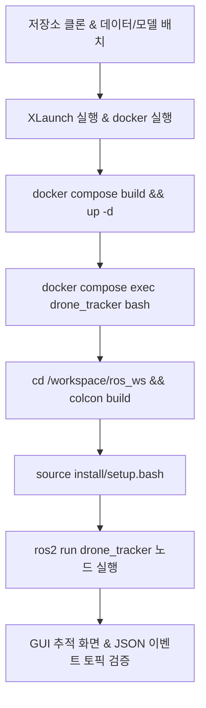

# 드론 탐지 및 객체 추적 시스템 (Drone Detection & Tracking Pipeline)

드론 이미지 및 시퀀스 데이터를 입력받아 YOLOv8n 기반 객체 탐지와 BoT-SORT 기반 추적을 수행하고, Track ID를 관리하며 표적의 출현(TARGET_APPEARED) 및 소실(TARGET_DISAPPEARED) 이벤트를 JSON 형식으로 발행하는 ROS 2 기반 파이프라인입니다.

---

## 목차
1. [프로젝트 소개](#1-프로젝트-소개)
2. [개발 및 실행 환경](#2-개발-및-실행-환경)
3. [프로젝트 구조](#3-프로젝트-구조)
4. [사전 준비 및 환경 구성](#4-사전-준비-및-환경-구성)
5. [설정 방법](#5-설정-방법)
6. [실행 및 단계별 재현 절차](#6-실행-및-단계별-재현-절차)
7. [ROS 2 인터페이스 및 이벤트 스키마](#7-ros-2-인터페이스-및-이벤트-스키마)
8. [결과 확인 및 검증 시나리오](#8-결과-확인-및-검증-시나리오)
9. [커밋 타입 및 규칙 (Commit Tags)](#9-커밋-타입-및-규칙-commit-tags)
10. [참고 자료 (References)](#10-참고-자료-references)

---

## 1. 프로젝트 소개

### 1.1 프로젝트 목적
도심, 자연, 건물, 구름 등 다양한 배경과 카메라 흔들림 환경에서 소형 비행체(드론)를 신속하고 안정적으로 식별·추적하고, 상태 변화(출현/소실)를 이벤트 로그로 구조화하여 상위 관제 시스템으로 전송할 수 있는 영상 분석 파이프라인을 구축합니다.

### 1.2 요구사항 및 구현 범위
- **객체 탐지 (Object Detection)**: Ultralytics YOLOv8n을 활용한 단일 이미지 및 연속 프레임 탐지
- **객체 추적 (Object Tracking)**: BoT-SORT 알고리즘을 통한 프레임 간 동일 객체 Track ID 유지 및 카메라 움직임 보상(GMC: sparseOptFlow)
- **상태 이벤트 판정 (Event Triggering)**:
  - **표적 출현**: 지정 횟수(`appear_streak_thres`) 연속 검출 시 안정적 표적으로 승격 및 출현 이벤트 발생
  - **표적 소실**: 지정 프레임(`track_buffer`) 동안 미검출 시 소실 판정 및 활동 지속 시간(`duration_sec`) 기록
- **미들웨어 통합 (ROS 2 Humble)**:
  - 검출 정보(`detections`) 및 이벤트 로그(`events`)를 표준 `std_msgs/msg/String` JSON 메시지로 토픽 발행
- **GUI 시각화**: 바운딩 박스, Track ID, 클래스명, 신뢰도 오버레이 및 실시간 재생

---

## 2. 개발 및 실행 환경

저장소의 `Dockerfile`, `docker-compose.yml`, `requirements.txt`를 기준으로 작성한 개발 및 실행 환경입니다.

| 구분 | 사양 및 버전 |
|---|---|
| 운영체제 (Host) | Windows 10/11 또는 Ubuntu 22.04 LTS |
| 컨테이너 OS | Ubuntu 22.04 LTS (`osrf/ros:humble-desktop-full`) |
| ROS 2 | Humble |
| Python | 3.10.x |
| 딥러닝 프레임워크 | Ultralytics (`>= 8.0.0`) |
| 영상 처리 | OpenCV (`>= 4.8.0`) |
| 선형 할당 라이브러리 | `lap >= 0.5.12` |
| 설정 및 수치 연산 | PyYAML (`>= 6.0`), NumPy (`>= 1.22.0`) |
| 추론 장치 | CPU 기본 사용, NVIDIA GPU 선택 가능 (별도 환경 구성 필요) |
| GUI 출력 | VcXsrv (Windows 환경) |

> [!NOTE]
> 기본 설정(`config.yaml`)은 `device: "cpu"`로 구성되어 있어 외장 GPU 없이도 실행할 수 있으며, GPU 사용 시 NVIDIA 드라이버 및 컨테이너 환경 구성이 필요합니다.

---

## 3. 프로젝트 구조

```
drone-detection-tracking/
├── Dockerfile                   # Ubuntu 22.04 + ROS 2 Humble + GUI/Python 환경 빌드 정의
├── docker-compose.yml           # 컨테이너 실행, 볼륨 마운트, X11 포워딩 설정
├── requirements.txt             # Python 의존성 패키지 목록
├── model/                       # 모델 가중치 저장 경로
├── data/
│   ├── image_test/              # 단일 이미지 테스트 데이터 저장 경로
│   └── sequence-test/           # 이미지 시퀀스 테스트 데이터 저장 경로
├── debug_images/                # image 모드 실행 시 결과 이미지 저장 경로
└── ros_ws/                      # ROS 2 워크스페이스
    └── drone_tracker/           # 메인 ROS 2 패키지
        ├── package.xml          # ROS 2 패키지 명세
        ├── setup.py             # 패키지 빌드 및 실행 진입점 등록
        ├── setup.cfg            # setuptools 설정
        ├── config/
        │   ├── config.yaml      # 실행 모드, 입출력 경로, 모델 및 이벤트 판정 파라미터 설정
        │   └── botsort.yaml     # BoT-SORT 트래커 하이퍼파라미터
        └── drone_tracker/
            └── object_detection_tracking_node.py  # 메인 탐지/추적/이벤트 발행 노드
```

---

## 4. 사전 준비 및 환경 구성

### 4.1 데이터셋 및 모델 가중치 준비
> [!IMPORTANT]
> **데이터 및 모델 파일 저장소 미포함 안내**
> 용량 문제 및 저작권 정책으로 인해 영상 시퀀스, 테스트 이미지, 사전학습 모델 가중치(`yolov8n.pt`)는 **Git 저장소에 업로드되어 있지 않습니다 (`.gitignore` 적용)**.
> 파이프라인을 정상 실행하려면 아래 링크에서 데이터를 다운로드하여 프로젝트 내 지정된 경로에 반드시 배치해야 합니다.

- **데이터셋 다운로드 링크**:
  - [DUT-Anti-UAV 저장소 (GitHub)](https://github.com/wangdongdut/DUT-Anti-UAV) (저장소 라이선스: Apache-2.0)
- **기본 모델 가중치 다운로드**:
  - [Ultralytics YOLOv8n (yolov8n.pt)](https://github.com/ultralytics/assets/releases/download/v8.2.0/yolov8n.pt)
- **다운로드 후 파일 배치 경로**:
  ```
  drone-detection-tracking/
  ├── model/
  │   └── yolov8n.pt                      # 준비한 모델 가중치
  └── data/
      ├── image_test/
      │   └── 01.jpg                      # 단일 이미지 테스트 샘플
      └── sequence-test/
          ├── video01/                    # 연속 프레임 시퀀스 폴더
          ├── video02/
          └── ...
  ```

---

### 4.2 GUI 화면 표시를 위한 X Server 설정 (Windows 호스트)
OpenCV의 GUI 창(`cv2.imshow`)을 컨테이너에서 Windows 호스트 화면으로 띄우기 위해 VcXsrv가 필요합니다.

1. **VcXsrv 다운로드 및 설치**:
   - [SourceForge VcXsrv 다운로드 페이지](https://sourceforge.net/projects/vcxsrv/)에서 최신 설치 파일(`vcxsrv-64.x.x.x.installer.exe`) 다운로드 및 설치
2. **XLaunch 실행 옵션 설정**:
   - **Display settings**: `Multiple windows` 선택, Display number: `0`
   - **Client startup**: `Start no client` 선택
   - **Extra settings**:
     - `Clipboard` 체크
     - `Primary Selection` 체크
     - `Native OpenGL` 체크
3. **방화벽 허용**: VcXsrv 최초 실행 시 Windows 방화벽 경고 창에서 개인/공용 네트워크 모두 허용

> [!TIP]
> **Linux 호스트**에서는 VcXsrv가 필요하지 않습니다. GUI 출력을 사용하려면 호스트의 X11 또는 Wayland 환경에 맞게 `DISPLAY` 환경 변수와 디스플레이 소켓을 설정해야 합니다. X11 환경에서는 `xhost`를 이용해 컨테이너의 접근 권한을 설정할 수 있습니다.

---

### 4.3 Docker 이미지 빌드 및 컨테이너 구동

```powershell
# 1. 저장소 루트 경로 이동
cd drone-detection-tracking

# 2. Docker 이미지 빌드
docker compose build

# 3. 백그라운드 모드로 컨테이너 실행
docker compose up -d

# 4. 컨테이너 셸 접속
docker compose exec drone_tracker bash
```

---

### 4.4 ROS 2 워크스페이스 빌드 (컨테이너 내부)

컨테이너 접속 후 다음 명령어로 ROS 2 패키지를 빌드하고 환경을 소싱합니다:

```bash
# 워크스페이스 디렉터리 이동
cd /workspace/ros_ws

# drone_tracker 패키지 빌드
colcon build

# 빌드 결과물 환경 소싱
source install/setup.bash
```

> [!NOTE]
> ROS 2 Humble 환경 설정은 컨테이너의 `~/.bashrc`에 자동 등록되어 있습니다.

---

## 5. 설정 방법

### 5.1 메인 설정 파일 (`ros_ws/drone_tracker/config/config.yaml`)
실행 모드, 입력 데이터 경로, 모델 가중치, 임계값 등을 제어합니다.

```yaml
# config/config.yaml
app_config:
  mode: "sequence"  # "image" 또는 "sequence"
  
  # 시퀀스 모드 설정
  sequence_input_dir: "/workspace/data/sequence-test/video01"
  
  # 모델 및 추론 설정
  model_name: "/workspace/model/yolov8n.pt"
  conf_thres: 0.25
  device: "cpu"
  playback_fps: 30
  
  # 이벤트 판정 설정
  appear_streak_thres: 6

  # 이미지 모드 설정
  image_input_path: "/workspace/data/image_test/v1.jpg"
  output_dir: "/workspace/debug_images"
  save_result: True
```

#### 파라미터 상세 설명

| 키 (Key) | 기본값 | 자료형 | 설명 |
| :--- | :--- | :---: | :--- |
| `mode` | `"sequence"` | string | 실행 모드. `"sequence"`(이미지 시퀀스 추적) 또는 `"image"`(단일 이미지 탐지) |
| `sequence_input_dir` | `"/workspace/data/sequence-test/video01"` | string | `sequence` 모드에서 사용할 이미지 시퀀스 디렉터리 경로 |
| `model_name` | `"/workspace/model/yolov8n.pt"` | string | YOLO 모델 가중치 파일 경로 |
| `conf_thres` | `0.25` | float | 객체 탐지 최소 신뢰도 임계값 |
| `device` | `"cpu"` | string | 추론 장치. `"cpu"` 또는 GPU 사용 시 `"0"` 등으로 지정 |
| `playback_fps` | `30` | int | 시퀀스 재생 속도 제어용 FPS. 프레임 간 대기시간은 `1000 / playback_fps` ms |
| `appear_streak_thres` | `6` | int | `TARGET_APPEARED` 이벤트 발생에 필요한 연속 검출 프레임 수 |
| `image_input_path` | `"/workspace/data/image_test/v1.jpg"` | string | `image` 모드에서 사용할 단일 이미지 파일 경로 |
| `output_dir` | `"/workspace/debug_images"` | string | 결과 이미지 저장 디렉터리 |
| `save_result` | `True` | bool | `True`이면 결과 이미지 저장, `False`이면 저장하지 않음 |

---

### 5.2 트래커 설정 파일 (`ros_ws/drone_tracker/config/botsort.yaml`)

Ultralytics BoT-SORT 설정을 패키지 내부에서 별도로 관리하여 추적 파라미터를 조정할 수 있도록 구성했습니다.

| 파라미터 | 기본값 | 설명 |
| :--- | :---: | :--- |
| `tracker_type` | `botsort` | 사용할 트래커 유형 |
| `track_high_thresh` | `0.25` | 1단계 매칭에 사용할 높은 신뢰도 임계값 |
| `track_low_thresh` | `0.1` | 2단계 매칭에 사용할 낮은 신뢰도 임계값 |
| `new_track_thresh` | `0.25` | 신규 트랙 생성을 위한 최소 신뢰도 |
| `track_buffer` | `30` | 미검출 트랙을 유지하는 프레임 수 (노드 내부 소실 판정 기준으로도 사용) |
| `match_thresh` | `0.8` | 트랙과 탐지 결과의 매칭 비용 임계값 |
| `fuse_score` | `True` | 매칭 비용 계산에 탐지 신뢰도 점수를 반영할지 여부 |
| `gmc_method` | `sparseOptFlow` | 카메라 움직임 보상 방식 (Sparse Optical Flow) |
| `with_reid` | `False` | ReID 기반 외형 특징을 이용한 재식별 기능 활성화 여부 |

---

## 6. 실행 및 단계별 재현 절차

저장소를 클론한 후 초기 상태에서 동일한 결과를 검증하고 실행하기 위한 전체 워크플로우입니다.



### [Step 1] GUI X Server 실행 (Windows 호스트)
- VcXsrv(XLaunch)를 실행합니다.

### [Step 2] 컨테이너 구동 및 접속 (호스트 터미널)
```powershell
docker compose build
docker compose up -d
docker compose exec drone_tracker bash
```

### [Step 3] 워크스페이스 빌드 및 환경 소싱 (컨테이너 터미널)
```bash
cd /workspace/ros_ws
colcon build
source install/setup.bash
```

### [Step 4] 메인 노드 구동
```bash
ros2 run drone_tracker object_detection_tracking_node
```

**### [Step 5] 토픽 모니터링 (새 호스트 터미널)**

호스트 터미널을 하나 더 열어 컨테이너에 접속한 뒤 실시간 토픽 메시지를 확인합니다. 여러 터미널을 한 화면에서 관리하려면 **Terminator**를 사용할 수 있습니다.

```bash
# 새 호스트 터미널에서 접속
docker compose exec drone_tracker bash

# 1. 출현/소실 이벤트 토픽 모니터링
ros2 topic echo /drone/tracker/events

# 2. 프레임별 탐지/추적 정보 모니터링
ros2 topic echo /drone/tracker/detections
```

### [Step 6] 정상 동작 확인 포인트
1. **터미널 초기 로그**: `YOLO 모델 로딩 중 (/workspace/model/yolov8n.pt)...` 출력
2. **시퀀스 처리 시작**: `--- [IMAGE SEQUENCE DETECTION & TRACKING START] ---` 및 총 프레임 수 출력
3. **GUI 시각화 창**: 호스트 모니터에 `YOLOv8 + BoT-SORT ROS2 Tracking` 창이 뜨며 초록색 바운딩 박스와 `ID:<track_id>` 오버레이 확인
4. **출현 이벤트 로그**: 드론이 `appear_streak_thres`(기본 6회) 연속 검출 시 `[EVENT JSON LOG]: TARGET_APPEARED` 콘솔 출력 및 `/drone/tracker/events` 토픽 발행
5. **종료**: 시각화 창 활성 상태에서 `q` 키 입력 시 노드가 안전하게 종료됩니다.

---

## 7. ROS 2 인터페이스 및 이벤트 스키마

### 7.1 토픽 목록

| 토픽명 | 메시지 타입 | 주기 / 발행 시점 | 내용 |
| :--- | :--- | :--- | :--- |
| `/drone/tracker/events` | `std_msgs/msg/String` | 상태 변화 시 비주기적 발행 | 표적 출현(`TARGET_APPEARED`) 및 소실(`TARGET_DISAPPEARED`) 이벤트 JSON |
| `/drone/tracker/detections` | `std_msgs/msg/String` | 객체 검출 시 프레임 단위 | 현재 프레임의 모든 유효 Track ID 및 Bounding Box JSON |

---

### 7.2 이벤트 JSON 스키마 (`/drone/tracker/events`)

#### A. 표적 출현 이벤트 (`TARGET_APPEARED`)
연속으로 `appear_streak_thres`(기본 6회) 프레임 이상 검출되었을 때 최초 1회 발행됩니다.

```json
{
  "timestamp": "2026-10-22T00:15:30.123456+09:00",
  "event": "TARGET_APPEARED",
  "target_info": {
    "track_id": 1,
    "class_name": "airplane",
    "confidence": 0.88,
    "coordinate_system": "image",
    "unit": "pixel",
    "bbox": [929, 559, 1172, 701],
    "center": {
      "x": 1050.5,
      "y": 630.0
    },
    "size": {
      "width": 243,
      "height": 142
    },
    "stability_count": 6
  }
}
```

#### B. 표적 소실 이벤트 (`TARGET_DISAPPEARED`)
이전에 출현이 확정되었던 표적이 `track_buffer`(기본 30프레임) 연속으로 미검출될 경우 발행됩니다.

```json
{
  "timestamp": "2026-10-22T00:15:45.654321+09:00",
  "event": "TARGET_DISAPPEARED",
  "target_info": {
    "track_id": 1,
    "class_name": "airplane",
    "appeared_at": "2026-10-22T00:15:30.123456+09:00",
    "duration_sec": 15.53,
    "coordinate_system": "image",
    "unit": "pixel",
    "last_bbox": [940, 560, 1180, 705],
    "last_center": {
      "x": 1060.0,
      "y": 632.5
    },
    "last_size": {
      "width": 240,
      "height": 145
    },
    "missing_count": 30
  }
}
```

---

### 7.3 프레임 탐지 JSON 스키마 (`/drone/tracker/detections`)
추적 중인 객체가 있는 프레임마다 실시간으로 발행됩니다.

```json
{
  "frame_idx": 45,
  "source_file": "00045.jpg",
  "detections": [
    {
      "track_id": 1,
      "class_name": "airplane",
      "confidence": 0.85,
      "bbox": [932, 558, 1175, 700]
    }
  ]
}
```

> [!IMPORTANT]
> **탐지 클래스 필터링 주의사항**:
> `object_detection_tracking_node.py`의 `self.model.track()` 호출에 `classes=[4, 14]` 옵션이 적용되어 있습니다. COCO 데이터셋 기준 Class 4는 `airplane`, Class 14는 `bird`입니다. 일반 사전학습 모델(`yolov8n.pt`)에서 해당 두 클래스만 탐지·추적하도록 설정한 것이며, 커스텀 가중치를 사용할 경우 클래스 ID에 맞게 설정을 조정해야 합니다.

---

## 8. 결과 확인 및 검증 시나리오

### 8.1 단일 이미지 검증 (`mode: "image"`)

1. `ros_ws/drone_tracker/config/config.yaml`에서 `app_config.mode`를 `"image"`로 변경합니다.
2. `app_config.image_input_path`에 테스트할 이미지 파일의 경로를 지정합니다.
3. `ros2 run drone_tracker object_detection_tracking_node` 명령어를 실행합니다.
4. 화면에 바운딩 박스가 표시된 결과 이미지가 팝업됩니다. 아무 키나 누르면 창이 닫히며, `app_config.save_result`가 `True`인 경우 `/workspace/debug_images/{원본이미지명}_result.jpg` 경로에 결과 이미지가 저장됩니다.

### 8.2 시퀀스 검증 및 소실 시나리오 테스트

[DUT Anti-UAV 데이터셋](https://github.com/wangdongdut/DUT-Anti-UAV)의 추적 시퀀스를 활용하여 표적 추적 및 출현·소실 이벤트 처리 동작을 검증합니다. 테스트 시 `config.yaml`의 `sequence_input_dir`을 대상 시퀀스 경로로 변경합니다.

- **근접 비행 (연속 추적 검증)**: `video01` (1050 프레임)
- **자연·수목 배경 (오탐 및 ID 스위칭 확인)**: `video02`, `video09`, `video10`, `video18`
- **카메라 흔들림 (카메라 움직임 보상 확인)**: `video07`, `video08`
- **표적 일시 소실 (소실 이벤트 처리 검증)**:
  - `video12`: 약 770~825 프레임 구간에서 표적 미검출 상황 확인
  - `video15`: 약 45~110 프레임 구간에서 표적 미검출 상황 확인

---

## 9. 커밋 타입 및 규칙 (Commit Tags)

본 저장소는 명확하고 일관된 형상 관리를 위해 다음과 같은 접두사 태그(`[<type>] <요약>`) 규칙을 따릅니다:

| 타입 태그 | 설명 |
| :--- | :--- |
| **`[feature]`** | 신규 기능 개발 및 새로운 모듈/파이프라인 추가 |
| **`[fix]`** | 버그 수정, 누락된 의존성 라이브러리 추가, 경로 오류 해결 |
| **`[refactor]`** | 기능 변경 없는 코드 구조 개선, 설정 분리, 가독성 향상 |
| **`[chore]`** | 빌드 설정 외의 단순 유지보수 (.gitignore, .gitkeep, 파일 복사/삭제 등) |
| **`[build]`** | ROS 2 패키지 초기화 및 빌드 시스템 관련 파일 설정 |

---

## 10. 참고 자료 (References)

- **데이터셋**: [DUT-Anti-UAV Benchmark](https://github.com/wangdongdut/DUT-Anti-UAV) (드론/소형 비행체 영상 추적 데이터셋, Apache-2.0)
- **객체 탐지 모델**: [Ultralytics YOLOv8](https://github.com/ultralytics/ultralytics) (소형 객체 탐지)
- **객체 추적 알고리즘**: BoT-SORT ([Robust Multi-Object Tracking with Bounding Box and Optical Flow](https://arxiv.org/abs/2206.14651))
- **로봇 미들웨어**: [ROS 2 Humble Hawksbill](https://docs.ros.org/en/humble/)